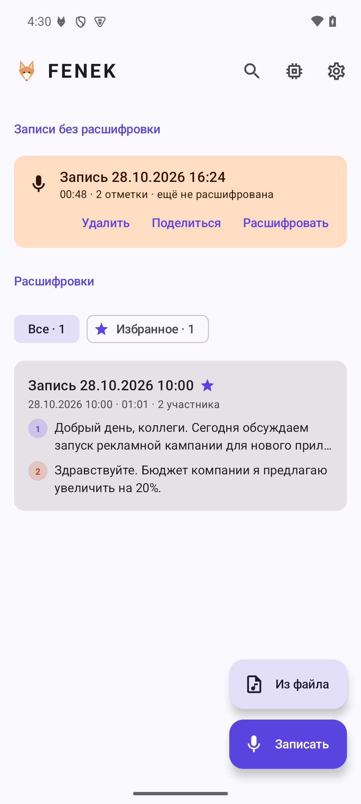
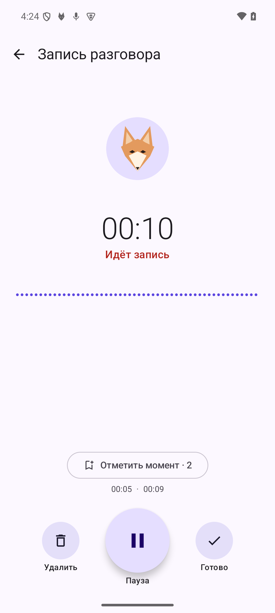
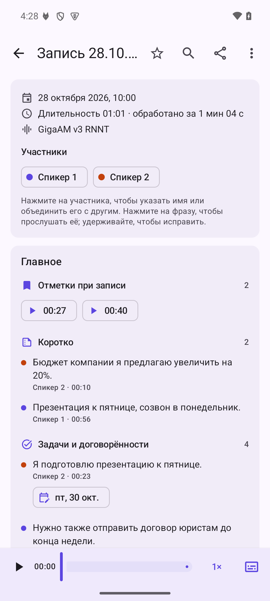
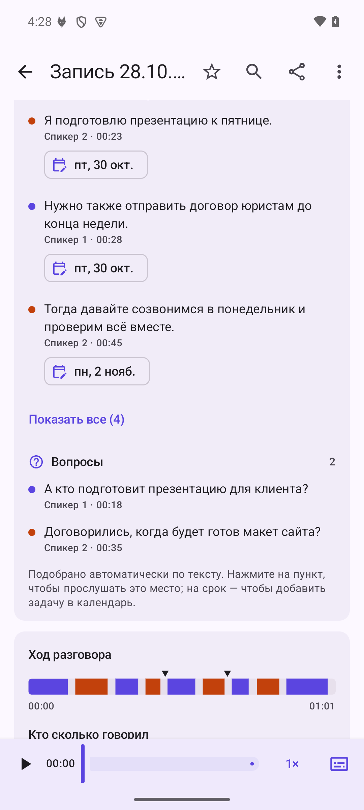
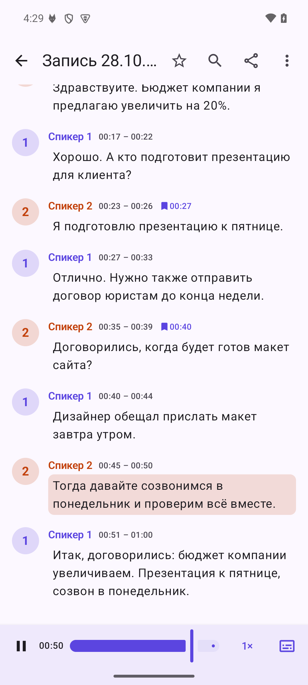

# FENEK — слышит всех, пишет всё

Офлайн‑расшифровка разговоров для Android. FENEK записывает разговор или берёт готовый
аудиофайл, распознаёт речь, определяет, кто говорит, и собирает структурированный диалог:
участники, реплики, временные метки. Локальная языковая модель расставляет пунктуацию, пишет
«Коротко» и находит задачи со сроками. Всё вычисляется **на телефоне**: записи и тексты не
покидают устройство, интернет нужен один раз, чтобы скачать модели.

| Главная | Запись | Главное | Задачи и ход разговора | Расшифровка |
|---|---|---|---|---|
|  |  |  |  |  |

## Установка и первый запуск

1. **Собрать APK** (подробности в разделе «Сборка»). Одна команда собирает две универсальные версии
   (все процессоры в одном файле), уже подписанные локальным отладочным ключом, в папку `dist/`:

   ```bash
   ./gradlew releaseApks
   adb install -r dist/FENEK-online-universal.apk
   ```

   - `FENEK-online-universal.apk` (около 53 МБ) скачивает модели при первом запуске, поэтому один
     раз нужен интернет (шаг 2).
   - `FENEK-fat-universal.apk` (около 1,4 ГБ) уже содержит набор моделей и настройки по умолчанию.
     При первом запуске она копирует модели из APK, интернет не нужен совсем (шаг 2 пропускается).
     Телефону нужно около 3 ГБ свободного места: сам APK и копия моделей.

   Такая подпись подходит для своего телефона, но не для Google Play.

2. **Для версии online: один раз откройте приложение с интернетом и скачайте модели.** На главном
   экране нажмите «Скачать»: обязательные модели весят 264 МБ, с языковой моделью 1,38 ГБ. Загрузка
   докачивается после обрыва, а без сети показывает причину и кнопку «Повторить».

3. **Дальше интернет не нужен.** Включите режим «в самолёте» и работайте: расшифровка, правка текста
   языковой моделью, просмотр и экспорт идут на устройстве. Приложение не отправляет записи,
   тексты и запросы никуда; сеть используется только для скачивания моделей.

Чтобы расшифровать запись: «Из файла» (или «Поделиться» из другого приложения) → «Определить» число
участников или указать его → «Расшифровать». Результат: «Экспорт» → «Сохранить в файл» →
«JSON расшифровки» (формат в [docs/OUTPUT_FORMAT.md](docs/OUTPUT_FORMAT.md)).

## Возможности

- **Запись прямо в приложении.**
  - Таймер, живая волна, пауза. Маскот — геометрический фенек: пока идёт запись, он
    поднимает уши в такт громкости.
  - **Отметки:** кнопка «Отметить момент» на экране записи и «Отметить» в уведомлении.
    Отмеченные места видны в расшифровке и на шкале разговора.
  - Запись продолжается с выключенным экраном: foreground‑служба типа «микрофон», в уведомлении «Пауза», «Отметить» и «Остановить».
  - Формат AAC (ADTS), около 29 МБ в час. Если приложение аварийно закроется, уже записанное не потеряется.
  - Нерасшифрованные записи ждут на главном экране: «Расшифровать», «Поделиться», «Удалить».
- **Запуск одним касанием:** плитка «Запись FENEK» в шторке уведомлений и ярлык «Записать»
  на значке сразу начинают запись. На Android 13+ плитку можно добавить из настроек.
- **Любые файлы:** MP3, M4A/AAC, OGG/Opus, FLAC, WAV, AMR, 3GP, звук из видео. Файл можно выбрать
  в приложении или прислать через «Поделиться» / «Открыть с помощью».
- **Кто говорил и когда.** Участники определяются автоматически, но число можно указать
  заранее. У каждой реплики есть время начала и конца. Если голоса всё же склеились,
  в меню расшифровки есть «Пересчитать участников» с нужным числом людей.
- **Языковая модель** (режимы включаются в настройках; по умолчанию включена только выжимка):
  - «Исправлять текст» (по умолчанию выключено: на GigaAM, который сам ставит пунктуацию, она не
    меняла WER, а обработка замедлялась): пунктуация, регистр и явные ошибки распознавания. Правка принимается,
    только если не заменила слова на другие и не изменила числа; иначе остаётся распознанный
    текст. У исправленной фразы есть метка «исправлено», по нажатию видно распознанный текст, а в
    диалоге правки — «Вернуть распознанный текст»;
  - «Выжимка и задачи» (по умолчанию включено): «Коротко» и список задач пишет модель. Если она не
    справилась или не успела, работают правила.
- **Главное** (если языковая модель не писала выжимку, строится по правилам для русского языка и
  частично для английского):
  - «Коротко» — 2–5 ключевых пунктов разговора;
  - «Задачи и договорённости» — обещания («подготовлю»), просьбы («пришлите»), планы
    («давайте перенесём»), а также предложения, на которые ответили «договорились».
    Сроки распознаются и переводятся в дату от дня разговора: «завтра к 15:30», «к пятнице»,
    «в следующую среду», «через неделю», «до конца месяца», «к 5 ноября». Нажатие на срок
    открывает календарь с готовым событием;
  - «Вопросы» — кто что спросил;
  - каждый пункт по нажатию воспроизводится с нужного места.
- **Ход разговора:** шкала всей записи, раскрашенная по участникам, с отметками. Нажатие
  переходит к этому месту.
- **Статистика разговора:**
  - кто сколько говорил: доля времени, число реплик;
  - кто говорит больше всех, у кого самый быстрый темп (слов в минуту), самый длинный монолог;
  - «О чём говорили» — ключевые темы. Нажатие на тему ищет её в тексте;
  - время обработки и **RTF** (время обработки / длительность записи) в заголовке расшифровки.
- **Избранное:** звёздочка в расшифровке, фильтр «Избранное» на главной.
- **Поиск** по всем расшифровкам с подсветкой фрагментов и внутри расшифровки с переходом
  между совпадениями.
- **Плеер:**
  - нажатие на фразу воспроизводит её;
  - караоке‑режим: текущая реплика подсвечивается, список прокручивается за звуком;
  - скорость 0,75–2×.
- **Правка:**
  - переименовать участника («Спикер 2» → «Иван»), объединить двух в одного;
  - сменить говорящего у фразы, исправить или удалить текст.
- **Экспорт:** TXT, Markdown‑заметка (выжимка, задачи чек‑листом, вопросы, отметки,
  статистика и темы), субтитры SRT и VTT, **JSON расшифровки** в формате задания
  `{"transcript": [{"speaker_id", "start_ms", "end_ms", "text"}]}`, «Расширенный JSON», сама
  аудиозапись, копирование текста. Любой формат можно отправить или сохранить в файл.
- **Длинные записи** обрабатываются блоками по 10 минут, поэтому память не переполняется.
  Обработка идёт в фоне с прогрессом в уведомлении.

## Как это работает

```
запись / файл ─► MediaCodec ─► 16 кГц моно PCM (на диске)
              ─► диаризация: pyannote segmentation 3.0 + голосовые «отпечатки» (3D-Speaker ERes2Net)
              ─► спектральная кластеризация по всей записи ─► непересекающиеся реплики
              ─► нарезка длинных реплик по паузам (≤ 25 с)
              ─► распознавание каждой реплики (GigaAM / Whisper / …)
              ─► [копия на случай сбоя] ─► языковая модель (llama.cpp):
                     правка текста с защитой, выжимка и задачи
              ─► расшифровка + главное + статистика + темы
```

1. **Декодирование** (`audio/AudioDecoder.kt`). MediaCodec, сведение в моно, полосовой
   ресемплер (windowed sinc) до 16 кГц. Результат пишется на диск.
2. **Диаризация** (`engine/Diarizer.kt`). Запись режется на блоки примерно по 10 минут в тихих
   местах, и модель pyannote segmentation находит участки речи. Затем одноголосая речь нарезается на
   окна по 2 с с шагом 1 с, для каждого окна считается голосовой «отпечаток», и отпечатки всей записи
   кластеризуются спектральным методом (`engine/SpectralClustering.kt`, `engine/VoiceClusters.kt`).
   Число участников можно задать; иначе оно выбирается по качеству кластеризации (1–6), а ползунок
   «Разделение голосов» сдвигает порог. Так «Спикер 1» остаётся одним и тем же человеком по всей записи.
3. **Реплики** (`engine/TurnBuilder.kt`). При наложении голосов слово остаётся за тем, кто уже
   говорит. Короткие «мигания» убираются, паузы внутри речи склеиваются.
4. **Распознавание** (`engine/Transcriber.kt`). Каждая реплика распознаётся отдельно, поэтому
   текст никогда не смешивает двух людей.
5. **Языковая модель** (`llm/`). Распознаватель закрывается, затем загружается GGUF-модель
   (по умолчанию Qwen2.5 1.5B Instruct) через llama.cpp. Правка идёт пачками по 8 реплик с жадным
   декодированием; ответ проходит защиту (`llm/CorrectionGuard.kt`). Выжимку модель пишет в JSON,
   форму которого задаёт грамматика GBNF, и каждый пункт ссылается на реплику.
   Если процесс погибнет внутри модели, расшифровка не пропадёт: копия с распознанным текстом
   сохраняется до запуска модели и подбирается при следующем старте.
6. **Аналитика.** `analytics/ConversationStats.kt`: время речи, темп, ключевые слова; для
   русского словоформы группируются («продажи», «продажам» → одна тема).
   `analytics/Highlights.kt`: правила для «Коротко», задач, вопросов и сроков (запасной вариант без
   языковой модели).

Движки: [sherpa-onnx](https://github.com/k2-fsa/sherpa-onnx) 1.13.8 (ONNX Runtime) для речи и
[llama.cpp](https://github.com/ggml-org/llama.cpp) v0.9.0 для языковой модели.

## Модели

Скачиваются один раз на главном экране или на экране «Модели»: с Hugging Face, при недоступности
с зеркал. Загрузка докачивается после обрыва, размер файлов проверяется.

| Назначение | Модель | Размер | Языки |
|---|---|---|---|
| Распознавание (по умолчанию) | GigaAM v3 RNNT, с пунктуацией | 232 МБ | русский |
| Распознавание | GigaAM v3 CTC, с пунктуацией | 225 МБ | русский |
| Распознавание | Zipformer RU (int8) | 73 МБ | русский, без пунктуации |
| Распознавание | Whisper Base / Small (int8) | 161 / 375 МБ | ≈100 языков |
| Распознавание | Parakeet TDT 0.6B v3 (int8) | 670 МБ | 25 европейских |
| Сегментация речи | pyannote segmentation 3.0 | 6 МБ | любой |
| Голосовые отпечатки | 3D-Speaker ERes2Net | 26,5 МБ | любой |
| Языковая модель (по умолчанию) | Qwen2.5 1.5B Instruct, Q4_K_M | 1,12 ГБ | русский, английский и др. |
| Языковая модель | Qwen2.5 0.5B Instruct, Q4_K_M | 491 МБ | то же, слабее |
| Языковая модель | Gemma 3 1B Instruct, Q4_K_M | 806 МБ | то же |

Вопросы и выжимка по правилам опираются на пунктуацию, поэтому с Zipformer (без пунктуации)
раздел «Главное» беднее; языковая модель это частично компенсирует.

## Сборка

Нужно:

| Что | Версия | Зачем |
|---|---|---|
| JDK | 17 и новее (проверено на 26) | Gradle и Kotlin |
| Android SDK | платформа API 37, build-tools 36.0.0 | сборка приложения |
| Android NDK | **29.0.14206865** (стабильный r29) | сборка llama.cpp |
| CMake | 3.22.1 | сборка llama.cpp |
| Свободное место | около 6 ГБ | NDK 2,4 ГБ, сборка 2 ГБ, исходники llama.cpp 0,2 ГБ, Gradle |
| Интернет | при первой сборке | NDK и CMake, `sherpa-onnx` (~50 МБ), исходники llama.cpp (~41 МБ) |

NDK и CMake Gradle ставит сам, если лицензия Android SDK принята (`sdkmanager --licenses`
или Android Studio). Нужна именно стабильная версия NDK: у `rc`/preview-версий другая,
«preview»-лицензия.

```bash
./gradlew assembleDebug      # отладочный APK версии online: app/build/outputs/apk/online/debug/app-online-debug.apk
./gradlew releaseApks        # обе релизные версии (R8, подпись) в dist/: FENEK-online-universal.apk и FENEK-fat-universal.apk
```

Версия `fat` кладёт в APK набор моделей из `app/bundled-models.json` (те же файлы и размеры, что в
каталоге моделей приложения; это проверяет тест). При первой сборке этой версии Gradle скачивает
их (около 1,4 ГБ) в кэш `~/.gradle/fenek-models/` и кладёт в сборку ссылки на эти файлы, поэтому
`clean` и следующие сборки ничего не качают. Отладочной сборки `fat` нет: `assembleDebug` её не затрагивает.

При первой сборке Gradle скачивает:

- `sherpa-onnx-1.13.8.aar` в `app/libs/`. Если GitHub недоступен, положите файл вручную со
  страницы релиза <https://github.com/k2-fsa/sherpa-onnx/releases/tag/v1.13.8>;
- исходники llama.cpp `v0.9.0` (коммит `cd959bae99ff4bed22bef2604f45241c09bbb8c8`) в
  `app/src/main/cpp/llama.cpp/`. В git они не попадают. Если каталог удалить, он будет
  скачан заново.

Нативная сборка (llama.cpp под `arm64-v8a` и `x86_64`) занимает около 6 минут при первой
сборке, потом берётся из кэша. Сборка для `armeabi-v7a` языковую модель не содержит:
приложение там работает без неё.

Юнит‑тесты (ресемплер, реплики, кластеризация, экспорт, аналитика, «Главное», поиск, языковая
модель и её защита):

```bash
./gradlew testDebugUnitTest
```

Тесты инструмента оценки WER/RTF:

```bash
cd tools/eval && python -m unittest
```

AGP 9.3.1, Gradle 9.5, Kotlin 2.4.20, Jetpack Compose (BOM 2026.09.00), minSdk 26,
targetSdk 37. Сборка даёт отдельный APK под каждый тип процессора и один универсальный.

## Оценка точности и скорости

`tools/eval/wer.py` считает WER, число говорящих и RTF по экспорту «JSON расшифровки» и проверяет его
схему. Подробности, методика и результаты: [docs/TEST_RESULTS.md](docs/TEST_RESULTS.md).

```bash
python tools/eval/wer.py --reference tools/eval/sample/reference.json \
    --hypothesis tools/eval/sample/export.json --processing-seconds 3 --duration-seconds 12.2
```

## Структура

```
app/src/main/java/app/fenek/
├── audio/      декодирование в PCM, ресемплер
├── record/     запись с микрофона, отметки, список записей
├── engine/     диаризация, кластеризация, реплики, распознавание, конвейер
├── llm/        языковая модель: llama.cpp через JNI, правка текста, выжимка, защита
├── analytics/  статистика, темы, «Главное»: выжимка, задачи, сроки, вопросы (правила)
├── model/      каталог моделей, загрузка с докачкой и зеркалами, план «скачать всё»
├── data/       расшифровки (JSON), поиск, настройки, копии на случай сбоя
├── export/     TXT / Markdown / SRT / VTT / JSON задания / расширенный JSON
├── service/    фоновая обработка, служба записи, плитка, уведомления
└── ui/         экраны на Jetpack Compose, знак FENEK (ui/brand)
app/src/main/cpp/   мост JNI и сборка llama.cpp
tools/eval/         WER, RTF и проверка схемы экспорта
docs/               архитектура, ограничения, формат результата, методика тестов
artifacts/          результаты тестов и материалы демонстрации
openspec/           спецификации поведения
```

## Что проверено

- Сборка debug и release (R8), 184 юнит‑теста приложения и 26 тестов инструмента оценки проходят.
- Размеры всех 25 файлов каталога моделей сверены с серверами.
- **Эмулятор Android 15 x86_64** (не телефон): загрузка набора моделей с прогрессом, докачка после
  принудительной остановки, ошибка без сети с «Повторить»; полный конвейер с языковой моделью
  (Qwen2.5 0.5B и 1.5B) в debug и в release с R8; отмена задания; сохранение JSON в файл; защита от
  сбоя модели; восстановление правки текста.
- Результаты на синтезированных диалогах (WER 3–7 %, число говорящих найдено верно) и скорость
  в эмуляторе: [docs/TEST_RESULTS.md](docs/TEST_RESULTS.md). На реальном телефоне приложение не
  запускалось, скорость там не измерялась.

## Советы и ограничения

Полный список: [docs/LIMITATIONS.md](docs/LIMITATIONS.md). Коротко:

- **Укажите число участников**, если оно известно: это самый надёжный способ избежать
  лишних или слитых «спикеров». Ошибки можно поправить вручную.
- Ползунок «Разделение голосов» в настройках сдвигает порог объединения похожих голосов.
- Одновременная речь не расшифровывается дважды: реплика остаётся за тем, кто начал первым.
- **Языковая модель замедляет обработку**: в эмуляторе на записи 63 с она добавила от 37 до 178 секунд.
  Если важна скорость, выключите «Исправлять текст» и «Выжимка и задачи» в настройках. Правка не
  изменила WER на GigaAM, который сам ставит пунктуацию.
- Без языковой модели «Главное» строится по правилам, а не нейросетью: задача, сказанная
  необычными словами, может не попасть в список, а случайная фраза с «надо» — попасть. Каждый
  пункт можно прослушать и проверить.
- Файлы, выбранные через системный диалог, не копируются. Если файл удалить, текст
  останется, но прослушивание станет недоступно.

## Лицензии моделей и библиотек

GigaAM — MIT; Whisper — MIT; Zipformer RU — Apache‑2.0; Parakeet — CC‑BY‑4.0;
pyannote segmentation 3.0 — MIT; 3D-Speaker ERes2Net — Apache‑2.0; Qwen2.5 — Apache‑2.0;
Gemma 3 — Gemma Terms of Use; sherpa-onnx — Apache‑2.0; llama.cpp — MIT.
